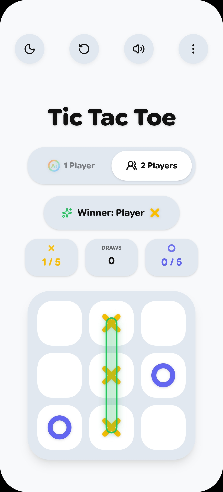
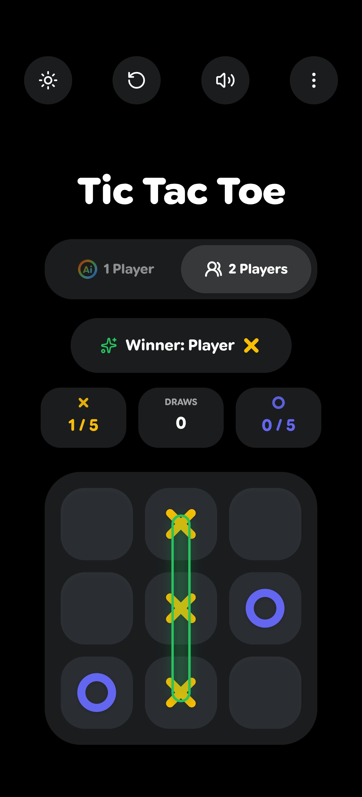
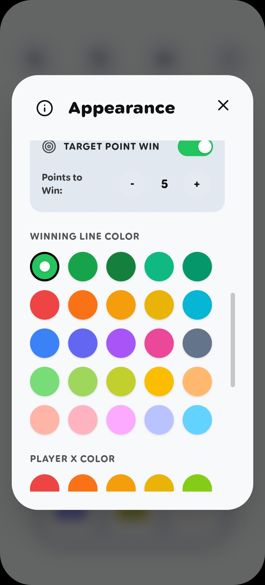
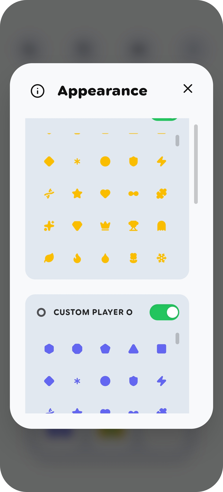
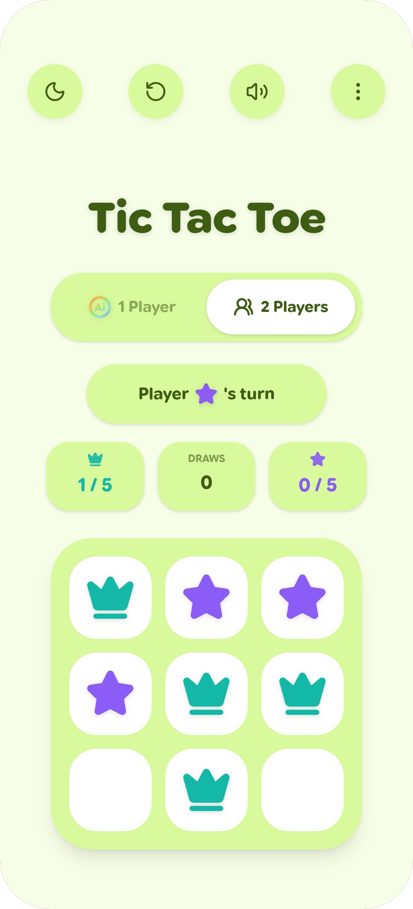
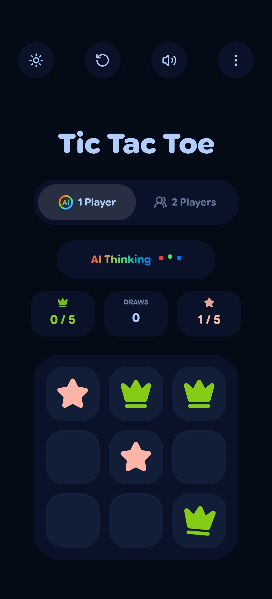

  
  <h1>Tic Tac Toe</h1>
  
A beautiful, fully responsive Tic Tac Toe game crafted with React and Google's Material You (M3) design system.

  <a href="https://anis-mondal.github.io/tic-tac-toe/"><picture><source media="(prefers-color-scheme: dark)" srcset="assets/play-dark.png"></picture></a>&nbsp;&nbsp;&nbsp;&nbsp;&nbsp;<a href="https://github.com/anis-mondal/tic-tac-toe/releases/latest"><picture><source media="(prefers-color-scheme: dark)" srcset="assets/download-dark.png"></picture></a>

  
   

  
  
  
  
  
  

 

## ✨ Key Features

* 🌐 **Web & Android Version:** Play instantly on your browser via the live website, or download the Android APK for a full native experience.
* 🤖 **Smart 1 Player Mode (AI):** Play against a highly intelligent AI powered by the Minimax algorithm.
* 👥 **2 Players Mode:** Play with a friend on the same device with a simple one-tap mode switch.
* 🎯 **Custom Target Score:** Set your own custom point target (1-20) to win the full match.
* 🧩 **200+ Custom Icons:** Personalize your gameplay by choosing from over 200 unique custom icons for your player avatars.
* 🎨 **Massive Customization:** Enjoy 25 dynamic Material You (M3) themes! Deeply customize your experience with 25 distinct color options for both 'X' & 'O', plus 25 different colors for the winning lines.
* 🌙 **Auto Dark/Light & Pitch Black Mode:** Seamlessly adapts to your system theme. Features a dedicated pure 'Pitch Black' mode for AMOLED screens alongside pure white backgrounds, ensuring an immersive experience without annoying screen flashes.
* 🎉 **Dynamic Confetti:** Beautiful victory animations that specifically match the winning player's chosen color.
* 📴 **Fully Offline (Android):** The Android app runs 100% locally on your device and requires zero internet connection.
* 📱 **Native Mobile Experience:** Enjoy smooth haptic feedback (vibrations), immersive audio, and proper native back-button support on the Android app.

## 🚀 Tech Stack

* 💻 **Frontend:** React.js, Vite, Tailwind CSS
* 📱 **Mobile Build:** Ionic Capacitor
* 🎨 **Icons & Animations:** Lucide React, Canvas Confetti

---
*Developed with ❤️ by Anis Mondal.*
